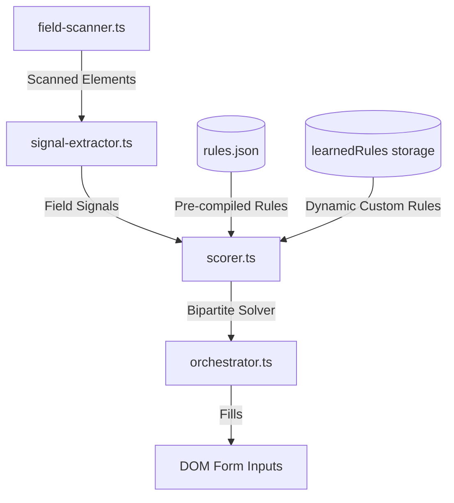

# Maintenance & Extension Guide: FormFilla Field Recognition

This guide details how to extend and maintain FormFilla's form scanning and autofilling engine, explaining the purpose of each key module, how to write rules, and where to apply modifications when new fields are not recognized.

---

## 1. Codebase Architecture Overview

FormFilla operates as a local-first, deterministic client-side engine with high functional cohesion and modular separation of concerns:



---

## 2. Which Files to Extend or Edit

Depending on the behavior you want to modify, target the following specific files:

### A. To Add Core Recognition Rules
*   **Target File**: [`src/shared/dictionary/rules.json`](file:///p:/JobApplier/src/shared/dictionary/rules.json)
*   **When to edit**: When a field exists in standard forms (like "Mobile Phone" or "ID Type") but is not mapped, or mapped with low confidence.
*   **Format**:
    ```json
    "personal.mobilePhone": {
      "sensitivityTier": "standard",
      "exactPhrases": [
        "mobile phone",
        "cell phone",
        "mobile no"
      ],
      "regexPatterns": [
        "mobile",
        "cell\\s*phone"
      ]
    }
    ```

### B. To Customize Acronyms and Word Norms
*   **Target File**: `src/shared/constants/abbreviations.json` (or dynamic equivalents)
*   **When to edit**: When labels use unusual acronyms or abbreviations (e.g. `Ph.` -> `Phone`, `DOB` -> `Date of Birth`) that cause matching to fail.

### C. To Adjust Scoring & Matching Weights
*   **Target File**: [`src/content/matching/scorer.ts`](file:///p:/JobApplier/src/content/matching/scorer.ts)
*   **When to edit**: To change the relative weights of signals (labels vs. placeholders vs. input names vs. IDs) or adjust thresholds (e.g. `HIGH_THRESHOLD`).
*   **Key variables**: `sources` weights list inside the `scoreField()` function.

### D. To Modify DOM Field Retrieval & Grouping
*   **Target File**: [`src/content/dom/field-scanner.ts`](file:///p:/JobApplier/src/content/dom/field-scanner.ts)
*   **When to edit**: When date fields or split arrays are containerized in a non-standard layout, or to modify which tag names are permitted for scanning.

### E. To Add Custom Fill Logics
*   **Target Files**: 
    - [`src/content/fill/select-filler.ts`](file:///p:/JobApplier/src/content/fill/select-filler.ts) (comboboxes/multi-selects)
    - [`src/content/fill/date-filler.ts`](file:///p:/JobApplier/src/content/fill/date-filler.ts) (date grouping/split months)
    - [`src/content/fill/file-filler.ts`](file:///p:/JobApplier/src/content/fill/file-filler.ts) (attachments/drop zones)
*   **When to edit**: To add custom formatting (e.g. month translation digits like Jan -> `1`) or upload fallbacks.

---

## 3. Best Practices for Adding Rules
1.  **Use specific regex bounds** (e.g., `\\bmobile\\b`) to avoid matching substrings in other fields (like `automobile`).
2.  **Declare correct Tag Allowed rules** (`allowedTags` or `allowedTypes`) to prevent text rules matching file inputs.
3.  **Keep bipartite matching in mind**: Rules are assigned 1-to-1 globally. Avoid duplicate patterns in different profile keys to prevent matching collisions.
