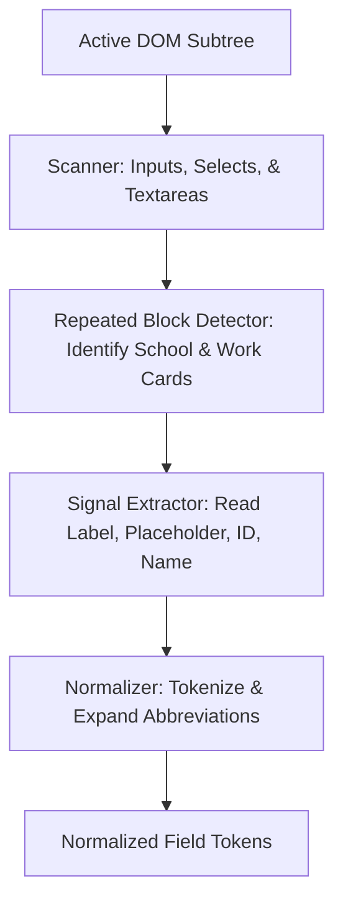
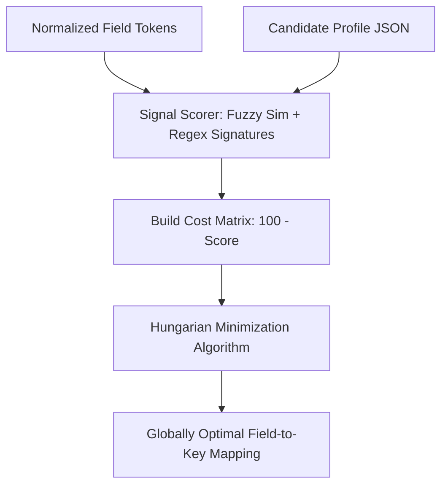
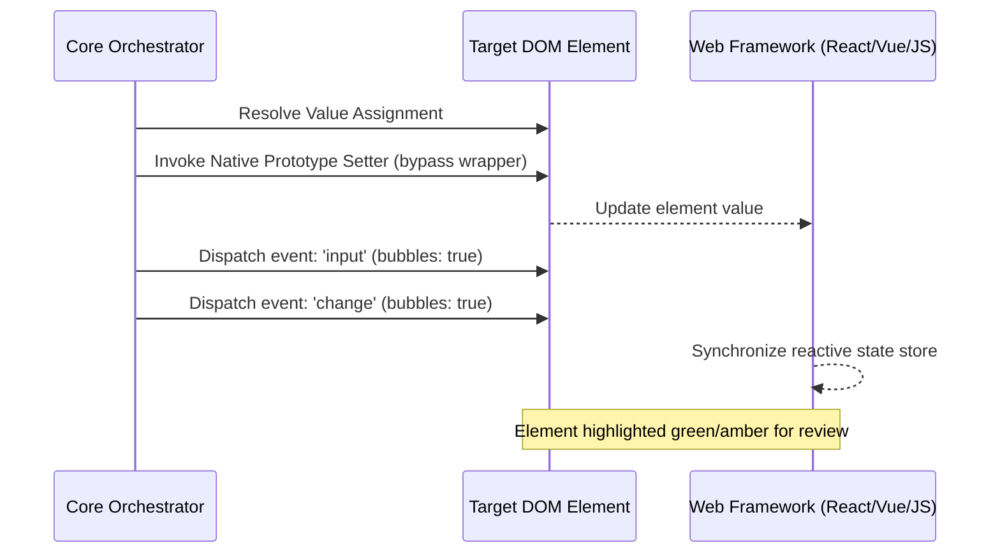

<p align="center">
  
</p>

<h1 align="center">FormFilla</h1>

<p align="center">
  <strong>The open-source, local-first form autofill engine for modern job applications, scholarships, and admissions.</strong>
</p>

<p align="center">
  <a href="LICENSE"></a>
  <a href="https://chromewebstore.google.com/detail/ghdmoobkedimgbgohodgmjmnldfmkcja?utm_source=item-share-cb"></a>
  <a href="https://typescriptlang.org"></a>
  <a href="#kuhn-munkres-hungarian-matching-engine"></a>
  <a href="#kuhn-munkres-hungarian-matching-engine"></a>
  <a href="#the-philosophy"></a>
</p>

<p align="center">
  <a href="https://chromewebstore.google.com/detail/ghdmoobkedimgbgohodgmjmnldfmkcja?utm_source=item-share-cb"><b>Install from Chrome Web Store</b></a> •
  <a href="#key-features"><b>Key Features</b></a> •
  <a href="#technical-architecture"><b>Architecture</b></a> •
  <a href="#setup--development"><b>Quickstart</b></a> •
  <a href="#ai-driven-dictionary-expansion"><b>Extending Rules</b></a> •
  <a href="https://github.com/AhmadHassan-BTed/FormFilla/issues"><b>Issues & Feedback</b></a>
</p>

<hr />

## The Philosophy

Job hunting in the modern era is exhausting and repetitive. Candidates spend hours copying and pasting identical professional records into applicant tracking systems (ATS) like Workday, Greenhouse, and Lever—systems whose built-in resume parsers frequently misalign dates, drop job titles, and scramble contact details.

**FormFilla was created to restore candidate dignity and reclaim time.**

Unlike cloud-based or LLM-driven autofill plugins that transmit your personal credentials, resume texts, and references to third-party AI endpoints, FormFilla is **100% local-first and deterministic**. Everything runs directly inside your browser in sub-100ms. Your sensitive career data never leaves your computer.

---

## Key Features

- ⚡ **Zero-AI & Sub-100ms Speed**  
  Uses deterministic bipartite optimization and regex heuristics instead of costly, slow, and hallucination-prone LLM API calls. No rate limits, no subscriptions, and zero cloud dependencies.

- 🧠 **Globally Optimal Matching (Kuhn-Munkres)**  
  Solves field-to-value assignment as a **Maximum Weight Bipartite Matching** problem. Rather than using naive greedy heuristics, it optimizes confidence scores across the entire form at once.

- 🛡️ **100% Private & Local-First**  
  All profile details, credentials, and uploaded files are stored strictly on-device via `chrome.storage.local` and IndexedDB. Zero network requests, zero telemetry.

- 🔄 **Framework-Safe DOM Writing**  
  Bypasses React, Vue, and Angular virtual DOM synthetic event wrappers by calling native HTML prototype setters and bubbling real `input` and `change` events.

- 📑 **Dynamic Repeated Block Detection**  
  Intelligently fingerprints and matches repetitive application sections, correctly mapping multi-card lists such as work experiences, degrees, certifications, references, and language proficiencies.

- 📁 **Automated File Transfers**  
  Simulates drag-and-drop operations using synthetic `DataTransfer` streams to attach your local resumes, CVs, cover letters, and transcripts directly to file inputs.

- 🎯 **Interactive Field Learner**  
  Encounter an obscure or bespoke form field? Open the interactive target mapper to click and teach FormFilla new field patterns right on the active page.

- 🎨 **Multi-Theme Support**  
  Designed for aesthetics and ergonomics, featuring **Light**, **Dark**, **Brutalist Light**, and **Brutalist Dark** palettes.

---

## Technical Architecture

FormFilla executes a robust three-stage pipeline to analyze and populate complex application forms:

```
Active DOM  ──►  1. Scanner & Normalizer  ──►  2. Hungarian Solver  ──►  3. Framework Setter  ──►  Filled Form
```

### 1. Element Scanning & Normalization

Recursively traverses active DOM subtrees (including same-origin iframe roots) to detect inputs, selects, textareas, and comboboxes. Raw signals (labels, placeholders, IDs, names, ARIA attributes) are tokenized and normalized against abbreviation dictionaries.



### 2. Kuhn-Munkres Bipartite Matching

Models the pairing between scanned form inputs and candidate profile fields as a weighted bipartite graph. FormFilla builds a global cost matrix and executes the Kuhn-Munkres (Hungarian) algorithm to guarantee the mathematically optimal assignment.



### 3. Framework-Safe DOM Writing

Standard `.value = ...` mutations fail on modern reactive web apps (React, Vue, Angular) because virtual DOM wrappers ignore raw property writes. FormFilla extracts browser-native property descriptors and dispatches bubbling lifecycle events.



---

## Repository Structure

```
FormFilla/
├── src/                   # Extension source code
│   ├── background/        # Service Worker & offline lifecycle
│   ├── content/           # Scanners, Kuhn-Munkres matcher, platform adapters & DOM setters
│   ├── options/           # Dashboard settings panel & profile management
│   ├── popup/             # Extension toolbar popup interface
│   ├── shared/            # Matching dictionaries, schemas, types & storage client
│   └── themes/            # Built-in CSS themes (Light, Dark, Brutalist)
├── tests/                 # Vitest test runner suites & HTML form fixtures
├── store_assets/          # Chrome Web Store graphics, banners, and screenshots
├── scripts/               # esbuild bundling, packaging, and icon build utilities
├── docs/                  # Architecture specifications and documentation
├── icons/                 # Extension icons (16, 32, 48, 128px)
├── manifest.json          # Chrome Manifest V3 configuration
├── LICENSE                # MIT License
└── package.json           # Node dependencies and build scripts
```

---

## Setup & Development

### Prerequisites

- **Node.js** (v20.0 or later recommended)
- **npm** (v10 or later)
- Google Chrome or any Chromium-compatible browser (Brave, Edge, Arc)

### 1. Clone & Install Dependencies

```bash
git clone https://github.com/AhmadHassan-BTed/FormFilla.git
cd FormFilla
npm install
```

### 2. Build the Extension

Compile the TypeScript code and static assets into the `dist/` directory:

```bash
# Single build
npm run build

# Watch mode for real-time development
npm run watch
```

### 3. Load Unpacked in Chrome

1. Open Google Chrome and navigate to `chrome://extensions/`.
2. Enable **Developer mode** via the toggle switch in the upper-right corner.
3. Click **Load unpacked** in the top-left corner.
4. Select the `dist/` directory inside this repository.
5. FormFilla is now active in your browser toolbar!

### 4. Running Tests

Run the Vitest unit and integration test suite:

```bash
npm run test
```

---

## AI-Driven Dictionary Expansion

FormFilla’s matching logic is completely decoupled from its code through four externalized JSON dictionaries. You can easily expand matching accuracy for specialized portals, regional formats, or regional application styles:

| File | Purpose | How to Extend |
| :--- | :--- | :--- |
| **[`rules.json`](src/shared/dictionary/rules.json)** | Field Selectors & Signatures | Add new target keys, `exactPhrases`, and `regexPatterns` for custom portal inputs. |
| **[`profile-template.json`](src/shared/dictionary/profile-template.json)** | Profile Schema Layout | Define user-facing fields and defaults matching any newly introduced rules. |
| **[`abbreviations.json`](src/shared/constants/abbreviations.json)** | Acronym Normalization | Map domain acronyms (e.g. `exp` → `experience`, `inst` → `institution`). |
| **[`degrees.json`](src/shared/constants/degrees.json)** | Education Ranking Matrix | Define degree equivalence tiers for international and regional qualifications. |

> **Pro Tip:** Each dictionary contains an embedded `__meta__` prompt. You can supply these JSON files directly to any AI model (Gemini, Claude, GPT) with sample forms to generate accurate new mapping entries!

---

## Platform Support

FormFilla contains dedicated platform adapters and generic fallback handling for:

- **Workday** (complex multi-step forms, radio groups, comboboxes)
- **Greenhouse** (file attachments, dynamic question rows)
- **Lever** (custom textarea fields, URL sections)
- **Taleo & Taleo Enterprise**
- **Scholarship & Admissions Portals** (Commonwealth, South Asian & GKS applications)
- **Generic HTML5 / Custom ATS forms**

---

## Installation via Chrome Web Store

If you prefer installing pre-packaged releases with automated updates, install FormFilla directly from the Google Chrome Web Store:

👉 **[Install FormFilla from the Chrome Web Store](https://chromewebstore.google.com/detail/ghdmoobkedimgbgohodgmjmnldfmkcja?utm_source=item-share-cb)**

---

## Contributing & Bug Reports

Contributions, issues, and feature suggestions are warmly welcomed!

- Found a form where autofill didn't match cleanly?
- Have an idea for a platform adapter or custom dictionary rules?

Please open an issue on our central tracker:  
👉 **[Open an Issue or Suggestion](https://github.com/AhmadHassan-BTed/FormFilla/issues)**

---

## License

This project is licensed under the **[MIT License](LICENSE)** © 2026 Ahmad Hassan (B-Ted). Free to use, modify, and distribute.
