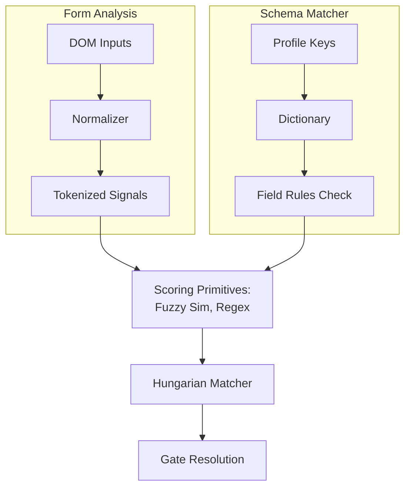

# Architectural Blueprint - Matching Engine

This document provides a technical breakdown of the matching and scoring subsystems in Hired.

---

## 1. Pipeline Overview

The matching engine matches unstructured DOM input nodes on dynamic web forms to structured fields inside the candidate's JSON profile.

---

## 2. Multi-Signal Scoring

Every field in the [rules.ts](../src/shared/dictionary/rules.ts) dictionary defines a matching policy consisting of exact phrases, regex patterns, autocomplete tokens, and type constraints.

Each input element is checked against all available dictionary rules:

### A. Autocomplete Tokens

If the element defines an `autocomplete` property that exactly matches a token listed in the dictionary rule, it receives a direct weight boost of `+45` points:
$$\text{Score}_{\text{autocomplete}} = 45$$

### B. Exact Phrase Match

The engine checks if any exact phrase listed in the rule's `exactPhrases` matches the tokenized input signal:
$$\text{Score}_{\text{exact}} = 35$$

### C. Regular Expression Matches

The engine evaluates the regex patterns against the signal tokens:
$$\text{Score}_{\text{regex}} = 20$$

### D. Fuzzy Similarity

Fuzzy similarity is calculated using the Jaro-Winkler metric and Dice's Coefficient, taking the maximum of the two:
$$\text{Similarity} = \max(\text{Dice}(A, B), \text{Jaro-Winkler}(A, B))$$
If the similarity exceeds `0.6`, it receives a scaled boost:
$$\text{Score}_{\text{similarity}} = \text{Similarity} \times 15$$

---

## 3. The Kuhn-Munkres (Hungarian) Resolver

To avoid greedy misassignments, Hired models the matching problem as a **Maximum Weight Bipartite Matching** problem:

- **Vertices (Left):** Candidate input fields on the active DOM subtree.
- **Vertices (Right):** Non-array keys defined in the candidate profile schema.
- **Edges:** Plausible assignments between fields and keys, with edge weights representing the calculated matching score.

The assignment is transformed into a minimization problem by defining the edge cost as:
$$\text{Cost}_{i,j} = 100 - \text{Score}_{i,j}$$

The Hungarian algorithm runs in $\mathcal{O}(V^3)$ time, where $V$ is the dimension of the padded square matrix. It calculates the assignment that maximizes the sum of matched weights across the entire page, ensuring globally optimal accuracy.

---

## 4. Sensitivity Gates

Once assigned, scored fields are classified into gate behaviors based on their risk level:

1. **`standard` (e.g. Job Title, Name):** Auto-filled directly at high (score $\ge 70$) or medium (score $\ge 40$) confidence.
2. **`sensitive` (e.g. Reference details, EEO data):** Auto-filled only at high confidence. Requires explicit user opt-in settings.
3. **`critical` (e.g. Passport/SSN):** Never auto-filled. The review highlighter overlays a persistent floating badge requiring a manual click to confirm injection.

---

## 5. AI Dictionary Expansion & Accuracy Performance

The scoring engine evaluates elements against raw data loaded from external JSON files. Making these dictionaries larger and more comprehensive directly enhances Hired's matching performance. The 4 target JSON databases to feed to AI models for expansion are:

1. **`src/shared/dictionary/rules.json` (Field Selectors):**
   Stores mapping directives. Expand the `exactPhrases` and `regexPatterns` to handle custom form inputs. Also contains `__arrayShapeSignatures__` which defines container mapping tags.
2. **`src/shared/dictionary/profile-template.json` (Profile Schema):**
   Stores export structures. Expand to support new candidate profile parameters.
3. **`src/shared/constants/abbreviations.json` (Acronym Mappings):**
   Stores normalization dictionaries. Expand to map short labels to full phrases.
4. **`src/shared/constants/degrees.json` (Degree Rankings):**
   Stores comparison rankings. Expand to compare international academic ranks.

_Each file includes a `__meta__` JSON block containing structured prompt engineering guidelines for AI models._
