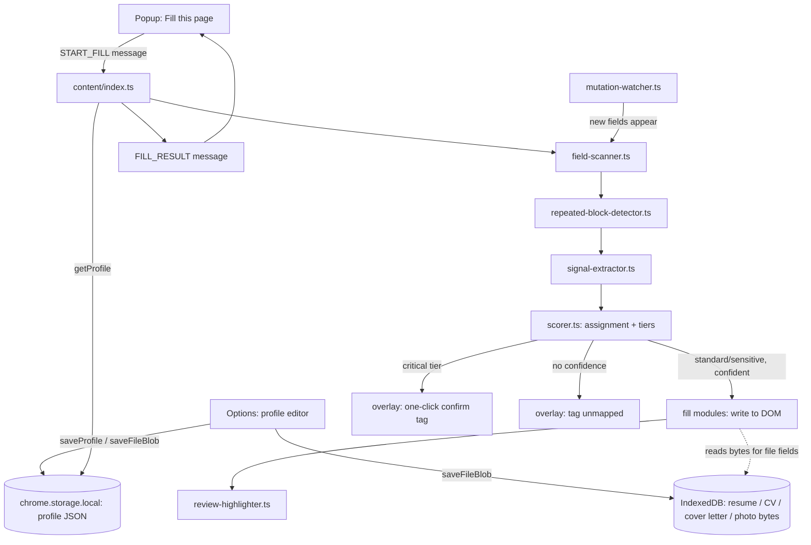

# ApplyEngine — Implementation Plan

**Document type:** Machine-executable architectural blueprint. **Audience:** an autonomous coding agent. **Rule for the agent:** build phases in the order given; do not start a phase until every file in the previous phase exists and (where a test is named) passes; within a phase, files may be built in any order unless a same-phase dependency is called out explicitly.

## 0. Project snapshot

| | |
|---|---|
| **Name** | ApplyEngine *(placeholder — rename freely)* |
| **Core purpose** | A browser extension that fills job-application forms from the user's own local profile data (JSON) and files. Every match is produced by deterministic rules, string algorithms, and combinatorial optimization — no AI model, no LLM call, no network request of any kind. |
| **Key features** | 1. Multi-signal field detection with confidence-scored autofill (never guesses blindly). 2. Globally-optimal field↔key assignment (Hungarian algorithm), not greedy first-match. 3. Structural repeated-block detection for education/experience/references, plus a highest-qualification reducer for single-value equivalents. 4. Framework-safe DOM writing for React/Angular-heavy ATS platforms. 5. File uploads (resume/CV, cover letter, photo) via synthetic `DataTransfer`. 6. Sensitivity-tiered fill behavior — national ID numbers and third-party contact info are never treated like a name or job title. 7. Visual review overlay and a manual trigger — nothing runs automatically, nothing auto-submits. |
| **Target browser(s)** | Chrome / Edge / Brave / Opera on Manifest V3 (primary). Firefox is manifest-compatible with one small branch (Phase 0). |
| **Explicit non-goals** | No AI/LLM anywhere in the matching or filling logic. No network calls. No automatic form submission. No data ever leaves the device. |

---

## 1. System pipeline & architecture design

### 1.1 Data flow



Step-by-step contract:

1. **Trigger** — the popup sends a `StartFillMessage` (`{type:'START_FILL', tabId}`) to the content script of the active tab. The user always presses the button; nothing fires on page load.
2. **Read profile** — `content/index.ts` calls `storageClient.getProfile()`, the *only* sanctioned path to `chrome.storage.local`.
3. **Scan** — `field-scanner.ts` returns every fillable node on the page and any same-permission iframe.
4. **Group** — `repeated-block-detector.ts` (§2.5) clusters structurally-identical sibling containers into indexed blocks (education #1, #2, ... / experience #1, #2, ... / references #1, #2, ...) before anything is scored, so a field's array index is known up front rather than guessed per-field.
5. **Extract** — `signal-extractor.ts` turns each element into a plain `FieldSignals` object, now including the block index/type assigned in step 4. From here on, nothing downstream touches the live DOM node except the fill layer.
6. **Score & assign** — `scorer.ts` scores every field against every candidate key (§2.1), then resolves *all* competing claims at once via optimal bipartite assignment (§2.1) rather than greedily. Sensitivity tiers (§2.1) gate what happens next.
7. **Fill** — standard/sensitive fields at sufficient confidence are written via the native-setter technique (§2.2); critical-tier fields are never auto-written — they get a one-click confirm affordance instead; zero-confidence fields are left untouched.
8. **Report** — the orchestrator returns a `FillResultMessage` (`{confident, review, unmapped, needsConfirm}` counts). No value data is echoed back — counts only.
9. **Re-run on change** — `mutation-watcher.ts` detects newly-rendered sections and re-invokes steps 3–8 for the new subtree only.

### 1.2 State management

- **Single source of truth:** `chrome.storage.local` for the profile JSON and settings; IndexedDB for binary blobs (resume/CV, cover letter, photo). Nothing else persists anything.
- **No shared mutable state, no module-level globals.** Every function receives what it needs as a parameter and returns a new value. Immutable, read-only tables (`constants.ts`, `dictionary.ts`) are configuration, not state.
- **Cross-context sync** (popup ⇄ content script ⇄ background — three separate JS realms in MV3 sharing no memory): only via (a) `chrome.storage` reads/writes, (b) one-shot messages in `messages.ts`, (c) `chrome.storage.onChanged` for reactive updates.
- **The background service worker holds no business state at all.** It relays messages and handles install/update lifecycle only. MV3 can terminate it at any moment.
- **What "separation of concerns" does *not* mean:** every context may still *call* `storage-client.ts`'s exported functions. `storage-client.ts` is the single door into persistence; every other context uses that same door rather than rolling its own `chrome.storage` calls.

### 1.3 SOLID mapping

- **Single responsibility** — `field-scanner.ts` only finds elements, `repeated-block-detector.ts` only groups them, `signal-extractor.ts` only reads attributes, `scorer.ts` only scores and assigns, `fill/*.ts` only writes.
- **Open/closed** — the generic engine is never edited to special-case a site; site behavior is added only via a new `PlatformAdapter` under `content/adapters/`.
- **Liskov substitution** — every adapter implements the identical `PlatformAdapter` interface interchangeably.
- **Interface segregation** — `types.ts` defines narrow interfaces (`FieldSignals`, `ScoredField`, `RepeatedBlock`, `PlatformAdapter`) rather than one large shape.
- **Dependency inversion** — `content/index.ts` depends on interfaces (`PlatformAdapter`, the storage-client contract), never on a concrete implementation.

### 1.4 Directory tree

```
applyengine/
├── docs/                  # Documentation
│   ├── assets/            # Documentation images & previews
│   └── infra/             # Infrastructure docs
├── infra/                 # Infrastructure & deployment
│   └── docker/            # Docker Compose & Dockerfile
├── scripts/               # Build & utility scripts
│   ├── build.js           # esbuild bundler
│   └── generate-icons.ps1 # Icon generation
├── src/
│   ├── assets/            # Static assets (logos, SVGs)
│   ├── background/
│   │   └── service-worker.ts
│   ├── content/
│   │   ├── index.ts
│   │   ├── dom/
│   │   │   ├── field-scanner.ts
│   │   │   ├── repeated-block-detector.ts
│   │   │   ├── signal-extractor.ts
│   │   │   └── mutation-watcher.ts
│   │   ├── matching/
│   │   │   ├── dictionary.ts
│   │   │   ├── normalizer.ts
│   │   │   ├── fuzzy.ts
│   │   │   ├── assignment.ts
│   │   │   └── scorer.ts
│   │   ├── fill/
│   │   │   ├── native-setter.ts
│   │   │   ├── select-filler.ts
│   │   │   ├── radio-checkbox-filler.ts
│   │   │   ├── date-filler.ts
│   │   │   ├── file-filler.ts
│   │   │   └── combobox-adapter.ts
│   │   ├── adapters/
│   │   │   ├── generic.ts
│   │   │   ├── workday.ts
│   │   │   ├── greenhouse.ts
│   │   │   └── lever.ts
│   │   └── overlay/
│   │       └── review-highlighter.ts
│   ├── options/
│   │   ├── options.html
│   │   ├── options.ts
│   │   └── options.css
│   ├── popup/
│   │   ├── popup.html
│   │   ├── popup.ts
│   │   └── popup.css
│   ├── shared/
│   │   ├── types.ts
│   │   ├── messages.ts
│   │   ├── storage-client.ts
│   │   └── constants.ts
│   └── themes/            # CSS theme files
├── icons/                 # Extension icons
├── store_assets/          # Chrome Web Store assets
├── tests/
│   ├── fixtures/
│   │   ├── generic-form.html
│   │   ├── workday-sample.html
│   │   └── greenhouse-sample.html
│   └── scorer.test.ts
├── .editorconfig
├── .env.example
├── .gitattributes
├── .gitignore
├── LICENSE
├── manifest.json
├── package.json
├── tsconfig.json
└── vitest.config.ts
```

---

## 2. Algorithmic definitions & problem solving

Five problems in this codebase are genuinely hard and must not be left to agent improvisation.

### 2.1 Multi-signal scoring, sensitivity tiers, and optimal assignment

Every `FieldRule` in `dictionary.ts` now carries a `sensitivityTier: 'standard' | 'sensitive' | 'critical'` (generalizing the old single-purpose EEO gate to every field, including `personal.nationalId` and `family.*`):

```
FUNCTION scoreField(signals: FieldSignals) -> Candidate[]:
  tokens = normalize(signals)
  candidates = []
  FOR EACH (candidateKey, rule) IN FIELD_RULES:
      IF rule.sensitivityTier == 'critical': PASS   // still scored — see gating below, just never silently auto-filled
      IF rule.sensitivityTier == 'sensitive' AND rule.requiresOptIn AND NOT profile.optIns[rule.optInKey]: CONTINUE
      IF NOT rule.typeCompatible(signals.type, signals.tagName): CONTINUE

      score = 0
      IF signals.autocomplete IN rule.autocompleteTokens: score += 45
      IF tokens EXACT_MATCHES rule.exactPhrases: score += 30
      IF ANY(rule.regexPatterns MATCHES tokens): score += 20
      similarity = MAX(diceCoefficient(tokens, phrase), jaroWinkler(tokens, phrase) FOR phrase IN rule.exactPhrases)
      IF similarity > 0.6: score += similarity * 15
      IF ANY(rule.negativePatterns MATCHES tokens): score -= 40
      score += blockContextBonus(signals.blockIndex, signals.blockType, candidateKey)   // from §2.5

      IF score >= LOW_THRESHOLD: candidates.push({ key: candidateKey, score, tier: rule.sensitivityTier })
  RETURN candidates

FUNCTION resolveAllFields(fieldsWithCandidates) -> ScoredField[]:
  // Build a bipartite graph: one side = fields (minus any already resolved by §2.5's
  // block-index keys, which are unique by construction and skip this step), the other
  // side = non-array candidate keys. An edge (f, k) exists with weight = f's score
  // against k, only if that score cleared LOW_THRESHOLD in scoreField() above.
  assignment = hungarianMaxWeightMatching(fieldsWithCandidates)   // §matching/assignment.ts — O(n^3), trivial at n<200
  FOR EACH (field, key, score) IN assignment:
      IF CONFIRM_PATTERN MATCHES relation(field, key's other claimants):
          treat as mirror: fill identically, not competing claims          // "Confirm email"
      confidence = score >= HIGH_THRESHOLD ? 'high' : 'medium'
      gate = FIELD_RULES[key].sensitivityTier == 'critical' ? 'needs-confirm'
           : (FIELD_RULES[key].sensitivityTier == 'sensitive' AND confidence != 'high') ? 'unmapped'
           : confidence
  RETURN assigned ScoredFields, tagged with { key, confidence, gate }
```

`HIGH_THRESHOLD = 70`, `LOW_THRESHOLD = 40` (in `constants.ts`). The Hungarian algorithm (Kuhn–Munkres) finds the assignment that **maximizes total score across every field at once**, instead of letting the first high scorer grab a key and forcing weaker fields to settle — this replaces the earlier greedy "highest score wins, re-score the loser" approach, which could leave a lower total-accuracy result when two fields are both plausible for two different keys.

**Gate semantics** (this is what "sensitivity tier" actually changes about behavior, not just data storage):
- `standard` — fills at `high` or `medium` confidence exactly as before.
- `sensitive` (e.g. `references[].*`, `family.*`) — only fills at `high` confidence; `medium`-confidence sensitive matches are left blank and flagged rather than filled, since a wrong guess touching someone else's information is worse than a wrong guess on your own job title. Always tagged distinctly in the overlay even when filled.
- `critical` (e.g. `personal.nationalId`, any future passport/SSN-equivalent field) — **never** written by the fill engine automatically, at any confidence. The matched field is annotated with a one-click "fill this in?" affordance in the overlay; the value is only written on explicit per-field user action, every time.

### 2.2 Framework-safe DOM value injection

Most ATS platforms are React or Angular apps. Setting `element.value = x` directly does not notify the framework — the field visually shows the value but the framework's internal state never sees it. The fix is to call the framework's own *native* property setter, bypassing its overridden one, then dispatch the events the framework listens for:

```
FUNCTION writeValue(element, value):
  IF element.tagName IN ['INPUT', 'TEXTAREA']:
      proto = element.tagName == 'TEXTAREA' ? HTMLTextAreaElement.prototype : HTMLInputElement.prototype
      nativeSetter = Object.getOwnPropertyDescriptor(proto, 'value').set
      nativeSetter.call(element, value)
      element.dispatchEvent(new Event('input',  { bubbles: true }))
      element.dispatchEvent(new Event('change', { bubbles: true }))
  ELSE IF element.tagName == 'SELECT':
      match = bestOptionMatch(element.options, value)
      IF match: writeValue(element, match.value)
  ELSE IF isCustomCombobox(element):
      runComboboxAdapter(element, value)
  // type=file is never handled here — it needs an async byte-fetch from IndexedDB first;
  // content/index.ts calls fillFileInput() (§2.4) directly for any documents.* key.

FUNCTION runComboboxAdapter(triggerElement, value):
  click(triggerElement)
  AWAIT nextAnimationFrame()
  proxyInput = triggerElement.querySelector('input') OR triggerElement
  FOR EACH char IN value:
      dispatchKeyEvents(proxyInput, char)
      AWAIT 10ms
  options = AWAIT waitForElements('[role="option"], li[data-option]', 1500ms)
  match = fuzzyBestMatch(options.map(textOf), value)
  IF match: click(options[match.index]); RETURN true
  dispatchKeyEvent(proxyInput, 'Escape')
  RETURN false
```

**Sequencing rule (in `content/index.ts`):** fields are written one at a time with an animation-frame yield between each — never in a tight synchronous loop.

### 2.3 Dynamic content & multi-step forms

```
FUNCTION watch(root, onNewFields):
  pending = new Set()
  flush = debounce(() => {
      nodes = Array.from(pending); pending.clear()
      newFields = nodes.flatMap(findFillableDescendants)
      IF newFields.length > 0: onNewFields(newFields)
  }, DEBOUNCE_MS)   // 400ms default

  observer = new MutationObserver(mutations => {
      FOR EACH m IN mutations:
          FOR EACH node IN m.addedNodes WHERE node.nodeType == ELEMENT_NODE:
              pending.add(node)
      flush()
  })
  observer.observe(root, { childList: true, subtree: true })
  RETURN observer.disconnect
```

Never re-scan the full document on every mutation. Cross-origin iframes: catch `SecurityError` on `frame.contentDocument`, record the blocked origin, offer a one-time `chrome.permissions.request` for that specific host via the popup.

### 2.4 File injection via synthetic `DataTransfer`

Covers resume/CV, cover letter, and photo identically — only the mime type and target dictionary key differ.

```
FUNCTION fillFileInput(inputEl, fileBytes, fileName, mimeType) -> boolean:
  file = new File([fileBytes], fileName, { type: mimeType })
  dt = new DataTransfer()
  dt.items.add(file)
  inputEl.files = dt.files
  inputEl.dispatchEvent(new Event('input',  { bubbles: true }))
  inputEl.dispatchEvent(new Event('change', { bubbles: true }))
  AWAIT nextAnimationFrame()

  IF inputEl.files.length == 0:
      dropZone = closestDropZone(inputEl)
      IF dropZone:
          dispatchDragEvents(dropZone, dt, ['dragenter','dragover','drop'])
          AWAIT nextAnimationFrame()
      IF inputEl.files.length == 0: RETURN false
  RETURN true
```

**Resume vs CV terminology:** `dictionary.ts`'s rule for the resume-like document key matches both "resume" and "cv"/"curriculum vitae" phrasing. If the user has populated *both* `documents.resume` and `documents.cv` as distinct files, a field whose label says specifically "CV" prefers `documents.cv` (falling back to `documents.resume` if absent), and vice versa for a field that says "resume."

### 2.5 Repeated-block detection & the highest-qualification reducer

Forms with "Add another education" / "Add another reference" clone a template N times. Two problems, one algorithm: (a) find the boundaries of each repeated instance, (b) decide whether a field belongs to entry `[i]` of an array, or should instead resolve to a single reduced value (e.g. a "Highest qualification" dropdown, where there's no repetition at all).

```
FUNCTION detectRepeatedBlocks(root) -> RepeatedBlock[]:
  containers = findCandidateContainers(root)   // elements with 2+ siblings each holding >=2 form fields
  groups = groupBy(containers, container => structuralFingerprint(container))
                                             // fingerprint = hash of the ordered {tagName+type} sequence
                                             // of that container's fields — shape only, never label text
  blocks = []
  FOR EACH group WHERE group.length >= 2:     // 2+ structurally identical siblings = a repeated template
      arrayKey = bestShapeMatch(group[0], FIELD_RULES.arrayShapeSignatures)
                                             // reuses normalize() + fuzzy.ts against each array key's
                                             // "expected shape" (e.g. education expects a school-like
                                             // label, a degree-like label, two date-like fields)
      SORT group BY document order
      FOR i, container IN ENUMERATE(group):
          blocks.push({ index: i, arrayKey, container, fields: findFillableDescendants(container) })
  RETURN blocks

FUNCTION blockContextBonus(blockIndex, blockType, candidateKey) -> number:
  IF blockIndex != null AND candidateKey == `${blockType}[${blockIndex}].*`: RETURN 15
  IF blockIndex == null AND candidateKey == `${arrayKeyRoot}.highest.*`:
      // no repeated block detected at all for this array key => the form wants ONE reduced value,
      // not per-entry data. Resolve using a ranking table, e.g. DEGREE_RANK for education:
      // sort profile.education by DEGREE_RANK[entry.degree] descending, take entry [0]
      RETURN 15
  RETURN 0
```

`DEGREE_RANK` (in `constants.ts`) maps qualification-name variants ("PhD", "Doctorate", "Master's", "MSc", "M.S.", "Bachelor's", "BSc", "Undergraduate", "Associate", "High School" ...) to a numeric rank, so "Bachelor's" and "B.S." resolve to the same level. The same reducer pattern extends to any future array field that might need a "just the top one" answer.

References (`references[].*`) use the identical block-detection path — they are treated exactly like education/experience for indexing purposes, just tagged `sensitive` rather than `standard` in the dictionary (§2.1).

---

## 3. Phased execution plan

Build in this order. Do not begin phase *N+1* until every file in phase *N* exists and, where a test file is named, that test passes.

### Phase 0 — Scaffolding

#### `manifest.json`
- **Objective:** declare the extension's shape to the browser.
- **Core logic/algorithm:** none — declarative only.
- **Input → Output:** none.
- **Dependencies:** none.
```json
{
  "manifest_version": 3,
  "name": "ApplyEngine",
  "version": "0.1.0",
  "description": "Fills job application forms from your own local profile data. No AI, no network calls.",
  "permissions": ["storage", "scripting", "activeTab"],
  "optional_host_permissions": ["<all_urls>"],
  "background": { "service_worker": "background/service-worker.js", "type": "module" },
  "action": { "default_popup": "popup/popup.html" },
  "options_page": "options/options.html",
  "content_scripts": [
    { "matches": ["<all_urls>"], "all_frames": true, "js": ["content/index.js"], "run_at": "document_idle" }
  ]
}
```
Firefox branch: replace `background.service_worker` with `background.scripts: ["background/service-worker.js"]` and add `"browser_specific_settings": {"gecko": {"id": "applyengine@yourdomain.example"}}`.

#### `package.json`, `tsconfig.json`
- **Objective:** TypeScript build tooling, strict mode on, one bundler entry per context.
- **Core logic/algorithm:** none — config. Suggested devDependencies: `typescript`, `esbuild` (or `vite`), `vitest` + `jsdom` for Phase 11.
- **Input → Output:** none.
- **Dependencies:** none.

### Phase 1 — Shared foundation

#### `src/shared/types.ts`
- **Objective:** the single source of truth for every cross-file data shape.
- **Core logic/algorithm:** pure type declarations, zero runtime code: `Profile` (now including `personal.summary`, `personal.nationalId`, `family: {fatherName?, motherName?}`, `references: ReferenceEntry[]`, `documents: Record<string, DocumentFile>`), `PersonalInfo`, `EducationEntry`, `ExperienceEntry`, `ReferenceEntry` (`{name, relationship, company?, title?, email?, phone?}`), `FieldSignals` (now including `blockIndex`, `blockType`), `RepeatedBlock`, `ScoredField` (now including `tier`, `gate`), `FillResult`, `PlatformAdapter`, `Message`.
- **Input → Output:** exported types only.
- **Dependencies:** none.

#### `src/shared/messages.ts`
- **Objective:** the exact, exhaustive contract for cross-context communication.
- **Core logic/algorithm:** discriminated union — `START_FILL`, `FILL_RESULT`, `PERMISSION_NEEDED`, `CONFIRM_FIELD` (new — user explicitly approving a single critical-tier fill) — each with a typed payload.
- **Input → Output:** `createStartFillMessage(tabId: number): StartFillMessage`, etc.
- **Dependencies:** `types.ts`.

#### `src/shared/storage-client.ts`
- **Objective:** the *only* file permitted to call `chrome.storage.*` or IndexedDB directly.
- **Core logic/algorithm:** thin typed wrapper; all binary blobs (resume, CV, cover letter, photo) route to IndexedDB, never `chrome.storage.local`.
- **Input → Output:** `getProfile(): Promise<Profile>`, `saveProfile(p: Profile): Promise<void>`, `getLearnedMapping(domain): Promise<FieldMap|null>`, `saveLearnedMapping(domain, map): Promise<void>`, `getFileBlob(key: string): Promise<ArrayBuffer>`, `saveFileBlob(key, bytes): Promise<void>`.
- **Dependencies:** `types.ts`.

#### `src/shared/constants.ts`
- **Objective:** every magic number and shared pattern.
- **Core logic/algorithm:** `HIGH_THRESHOLD`, `LOW_THRESHOLD`, `DEBOUNCE_MS`, `ABBREVIATION_MAP`, `CONFIRM_PATTERN`, `DEGREE_RANK` (new).
- **Input → Output:** exported constants.
- **Dependencies:** none.

### Phase 2 — Matching primitives

*(Pure functions, no DOM access — independently unit-testable without a browser.)*

#### `src/content/matching/dictionary.ts`
- **Objective:** the canonical field-matching ruleset.
- **Core logic/algorithm:** exports `FIELD_RULES: Record<string, FieldRule>`, each carrying `sensitivityTier`. Covers `personal.firstName/lastName/middleName/email/phone/summary/nationalId` (nationalId: `critical`), `address.*`, `links.*`, `workAuthorization.*`, `education[].*` + `education.highest.*` reducer key, `experience[].*`, `references[].*` (`sensitive`), `family.fatherName/motherName` (`sensitive`), `documents.resume/cv/coverLetter/photo` (resume/cv synonym handling per §2.4), `eeo.*` (`sensitive`, opt-in gated). Also exports `arrayShapeSignatures` used by `repeated-block-detector.ts` to tell education/experience/references apart by aggregate shape.
- **Input → Output:** exports `FIELD_RULES` and `arrayShapeSignatures` only; no other file defines a matching rule.
- **Dependencies:** `constants.ts`.

#### `src/content/matching/normalizer.ts`
- **Objective:** turn a raw signal bundle into normalized tokens.
- **Core logic/algorithm:** lowercase → strip non-alphanumeric (keep spaces) → split camelCase/snake_case/kebab-case → expand via `ABBREVIATION_MAP` → collapse whitespace.
- **Input → Output:** `normalize(signals: FieldSignals): string[]`.
- **Dependencies:** `constants.ts`, `types.ts`.

#### `src/content/matching/fuzzy.ts`
- **Objective:** string-similarity primitives, no external dependency.
- **Core logic/algorithm:** Dice's coefficient as the primary metric; Jaro-Winkler added as a second metric (better on short strings with shared prefixes, common in field labels) — `scoreField` takes the max of the two; Levenshtein as a tiebreaker under 6 characters.
- **Input → Output:** `diceCoefficient(a, b): number`, `jaroWinkler(a, b): number`, `bestMatch(candidates: string[], target: string): {index, score}`.
- **Dependencies:** none.

#### `src/content/matching/assignment.ts`
- **Objective:** globally-optimal field↔key assignment — new file, replaces ad hoc greedy conflict resolution.
- **Core logic/algorithm:** Hungarian algorithm (Kuhn–Munkres) over the bipartite graph of {fields} × {non-array candidate keys}, edge weight = score, edges below `LOW_THRESHOLD` excluded before the algorithm runs (so it never forces a bad match just to maximize a sum). O(n³), trivial at real-world form sizes (n < 200).
- **Input → Output:** `hungarianMaxWeightMatching(candidates: FieldCandidates[]): Assignment[]`.
- **Dependencies:** `constants.ts`, `types.ts`.

#### `src/content/matching/scorer.ts`
- **Objective:** implement §2.1 exactly.
- **Core logic/algorithm:** as specified in §2.1 — scores every field, then delegates the global resolution step to `assignment.ts`, then applies sensitivity-tier gating.
- **Input → Output:** `scoreField(signals: FieldSignals): Candidate[]`, `resolveAllFields(fieldsWithCandidates): ScoredField[]`.
- **Dependencies:** `dictionary.ts`, `normalizer.ts`, `fuzzy.ts`, `assignment.ts`, `constants.ts`, `types.ts`.

### Phase 3 — DOM detection layer

*(Reads the page. Never writes to it.)*

#### `src/content/dom/field-scanner.ts`
- **Objective:** enumerate every candidate fillable element on the page and in same-permission iframes.
- **Core logic/algorithm:** query `input:not([type=hidden]), select, textarea, [contenteditable], [role=combobox], [role=radiogroup] input, [type=file]`; recurse into accessible iframes; catch and record blocked cross-origin frames; also detects three-part date groups (adjacent month/day/year `<select>`s in a common container) as a `DateFieldGroup`.
- **Input → Output:** `scanForFields(root: Document | Element): (Element | DateFieldGroup)[]`.
- **Dependencies:** `types.ts`.

#### `src/content/dom/repeated-block-detector.ts`
- **Objective:** implement §2.5's `detectRepeatedBlocks` exactly — new file.
- **Core logic/algorithm:** as specified in §2.5.
- **Input → Output:** `detectRepeatedBlocks(root: Document | Element): RepeatedBlock[]`.
- **Dependencies:** `field-scanner.ts`, `matching/dictionary.ts`, `matching/fuzzy.ts`, `matching/normalizer.ts`.

#### `src/content/dom/signal-extractor.ts`
- **Objective:** gather every signal for one element.
- **Core logic/algorithm:** resolve label via `for`/wrapping `<label>`/`aria-label`/`aria-labelledby`; `placeholder`; `name`/`id` (tokenized); `autocomplete`; `type`/`tagName`; nearby text via `getBoundingClientRect()` proximity; closest `<legend>`; `<select>` option text list; `blockIndex`/`blockType` read directly from the `RepeatedBlock` the element belongs to (from `repeated-block-detector.ts`), not re-derived.
- **Input → Output:** `extractSignals(el: Element, blocks: RepeatedBlock[]): FieldSignals`. Pure read.
- **Dependencies:** `types.ts`.

#### `src/content/dom/mutation-watcher.ts`
- **Objective:** implement §2.3 exactly.
- **Input → Output:** `watch(root: Node, onNewFields: (els: Element[]) => void): () => void`.
- **Dependencies:** `field-scanner.ts`, `constants.ts`.

### Phase 4 — Fill engine

*(Writes to the page. Receives the value to write as a plain argument — never reads storage itself.)*

#### `src/content/fill/native-setter.ts`
- **Objective:** implement §2.2's `writeValue` for `INPUT`/`TEXTAREA`.
- **Input → Output:** `setNativeValue(el: HTMLInputElement | HTMLTextAreaElement, value: string): void`.
- **Dependencies:** none.

#### `src/content/fill/select-filler.ts`
- **Objective:** fuzzy-match a value against a `<select>`'s option text.
- **Input → Output:** `fillSelect(el: HTMLSelectElement, value: string): boolean`.
- **Dependencies:** `fuzzy.ts`, `native-setter.ts`.

#### `src/content/fill/radio-checkbox-filler.ts`
- **Objective:** pick the correct option in a radio/checkbox group.
- **Core logic/algorithm:** match each option's own label text against the desired value; `.click()` the winner — never set `.checked` directly.
- **Input → Output:** `fillChoiceGroup(elements: Element[], value: string): boolean`.
- **Dependencies:** `fuzzy.ts`.

#### `src/content/fill/date-filler.ts`
- **Objective:** fill a date regardless of the widget shape.
- **Core logic/algorithm:** detect native `<input type=date>` vs a `DateFieldGroup` vs free-text with a format inferred from `placeholder`.
- **Input → Output:** `fillDate(field: HTMLInputElement | DateFieldGroup, isoDate: string): boolean`.
- **Dependencies:** `select-filler.ts`, `native-setter.ts`.

#### `src/content/fill/file-filler.ts`
- **Objective:** implement §2.4 exactly (resume/CV, cover letter, photo — identical mechanism, different mime type).
- **Input → Output:** `async fillFileInput(el: HTMLInputElement, fileBytes: ArrayBuffer, fileName: string, mimeType: string): Promise<boolean>`.
- **Dependencies:** none (bytes passed in — never touches `storage-client.ts` directly).

#### `src/content/fill/combobox-adapter.ts`
- **Objective:** implement §2.2's `runComboboxAdapter`.
- **Input → Output:** `async fillCombobox(triggerEl: Element, value: string): Promise<boolean>`.
- **Dependencies:** `fuzzy.ts`.

### Phase 5 — Review overlay

#### `src/content/overlay/review-highlighter.ts`
- **Objective:** visually tag each processed field so the human reviews before submitting.
- **Core logic/algorithm:** colored outline — green (confident/standard), amber (review or sensitive-tier), gray (unmapped) — fading after ~6s or on next focus; **plus** a distinct persistent badge + inline button for `needs-confirm` (critical-tier) fields that stays until clicked, since these must never fade away unfilled without the user noticing.
- **Input → Output:** `tagField(el: Element, tier: 'confident' | 'review' | 'unmapped' | 'needs-confirm', onConfirm?: () => void): void`.
- **Dependencies:** none.

### Phase 6 — Orchestration

#### `src/content/index.ts`
- **Objective:** the content script's only entry point. Coordinates scan → group → score → fill → tag.
- **Core logic/algorithm:** on `START_FILL`: read profile → `scanForFields` → `detectRepeatedBlocks` → `extractSignals` per element → `scoreField` + `resolveAllFields` → loop through results sequentially with an animation-frame yield between each, dispatching to the matching `fill/*.ts` module (or `fillFileInput` for `documents.*` keys) for `gate in {confident, review}`, and to `overlay.tagField(..., 'needs-confirm', onConfirm)` for `gate === 'needs-confirm'` — the actual write only happens inside that `onConfirm` callback, on explicit user click. Registers `mutation-watcher.ts` once. Replies with `FillResultMessage`.
- **Input → Output:** listens for `StartFillMessage`; emits `FillResultMessage`; otherwise its effect is DOM mutation.
- **Dependencies:** everything in `dom/`, `matching/`, `fill/`, `overlay/`, `adapters/`, `shared/storage-client.ts`, `shared/messages.ts`.

### Phase 7 — Background service worker

#### `src/background/service-worker.ts`
- **Objective:** lifecycle and relay only.
- **Core logic/algorithm:** on install, seed an empty default profile if none exists; relay a popup→tab message only if the popup cannot reach the tab directly.
- **Input → Output:** message in, message out; no persistent in-memory state.
- **Dependencies:** `shared/messages.ts`, `shared/storage-client.ts`.

### Phase 8 — Popup UI

#### `src/popup/popup.html`, `popup.ts`, `popup.css`
- **Objective:** one "Fill this page" button and a last-run summary.
- **Core logic/algorithm:** on click, send `START_FILL`, render `{confident, review, unmapped, needsConfirm}` counts. A link opens options.
- **Input → Output:** sends `StartFillMessage`; receives `FillResultMessage`.
- **Dependencies:** `shared/messages.ts`.

### Phase 9 — Options UI

#### `src/options/options.html`, `options.ts`, `options.css`
- **Objective:** a form-based editor over `Profile` — now including summary, references (with add/remove rows), family info, national ID, and file pickers for resume/CV/cover letter/photo — plus raw-JSON import/export.
- **Core logic/algorithm:** on save, validate required fields and basic types (no schema-validation library), then `storageClient.saveProfile()`; each file picker reads its file as `ArrayBuffer` and calls `storageClient.saveFileBlob()` under its own key.
- **Input → Output:** form state in; storage writes out via `storage-client.ts`.
- **Dependencies:** `shared/types.ts`, `shared/storage-client.ts`.

### Phase 10 — Platform adapters

#### `src/content/adapters/generic.ts`
- **Objective:** defines the `PlatformAdapter` interface; the default.
- **Input → Output:** `interface PlatformAdapter { matches(): boolean; beforeScan?(): void; scoreOverride?(signals: FieldSignals): ScoredField | null }`.
- **Dependencies:** `types.ts`.

#### `src/content/adapters/workday.ts`, `greenhouse.ts`, `lever.ts`
- **Objective:** detect the platform via DOM fingerprint; supply hand-tuned overrides for known combobox quirks, layered on top of the generic scorer.
- **Input → Output:** same `PlatformAdapter` interface.
- **Dependencies:** `fill/combobox-adapter.ts`, `matching/scorer.ts`.

### Phase 11 — Test harness

#### `tests/fixtures/*.html`
- **Objective:** anonymized real-form DOM snippets — generic, plus one per adapter, plus one containing a repeated "add another reference" block for §2.5 coverage.

#### `tests/scorer.test.ts`
- **Objective:** load each fixture into `jsdom`, run the full scan → block-detect → score → assign pipeline, assert expected field→key mapping, confidence tier, *and* gate (confident/review/unmapped/needs-confirm) for every field.
- **Dependencies:** everything above.

---

## 4. Edge cases, fallbacks & error handling

| Failure point | Mitigation | Owning file |
|---|---|---|
| Unknown or unusual DOM structure on a site with no adapter | Generic engine makes no site-specific assumptions; unrecognized fields degrade to lower scores or `unmapped`, never a crash | `scorer.ts` |
| Custom widget doesn't respond to synthetic events | `combobox-adapter.ts` checks the widget's displayed value after the attempt; on mismatch returns `false` rather than a false success | `combobox-adapter.ts`, `review-highlighter.ts` |
| `chrome.storage.local` quota exceeded by resume/CV/photo files | All binary blobs route to IndexedDB exclusively, never `chrome.storage.local` | `storage-client.ts` |
| Service worker terminated mid-task (MV3 ephemeral SW) | Never on the critical path of a fill — content script reads storage directly | `index.ts`, `service-worker.ts` |
| Cross-origin iframe without host permission | `SecurityError` caught and recorded; popup offers one-time `chrome.permissions.request` for that origin | `field-scanner.ts`, `popup.ts` |
| `MutationObserver` storm on a highly dynamic page | Debounced at `DEBOUNCE_MS`, diffed to newly added subtrees only | `mutation-watcher.ts` |
| Synthetic file-input assignment rejected by strict site validation | Falls back to a synthesized `drop` event on any detected drop-zone; if both fail, flags for manual upload | `file-filler.ts` |
| Photo rejected by client-side dimension/size validation | Treated identically to a rejected file assignment above — flagged for manual upload rather than reported as filled; the extension does not attempt image resizing | `file-filler.ts` |
| Duplicate/mirror fields (`Email` + `Confirm Email`) | `resolveAllFields()` detects the confirm/repeat relationship via `CONFIRM_PATTERN` and fills both identically rather than treating them as competing claims | `scorer.ts` |
| Repeated-block detection finds an unexpected shape (e.g. a form's "add another" pattern doesn't match the fingerprint heuristic) | Falls back to treating every field independently via the flat, non-block scoring path — degrades to pre-§2.5 behavior for that section rather than failing the whole page | `repeated-block-detector.ts`, `scorer.ts` |
| Sensitive fields (`references[].*`, `family.*`) | `sensitivityTier: 'sensitive'` — only auto-fills at high confidence; always visibly tagged even when filled | `dictionary.ts`, `scorer.ts` |
| Critical fields (`personal.nationalId`) | `sensitivityTier: 'critical'` — never auto-filled at any confidence; surfaced as a one-click confirm affordance, every time | `dictionary.ts`, `scorer.ts`, `review-highlighter.ts` |
| Fill speed outrunning the page's own re-renders | `index.ts` awaits one animation-frame yield between each field write | `index.ts` |
| Network disconnects | Out of scope by construction — zero `fetch`/`XHR` calls anywhere | — |